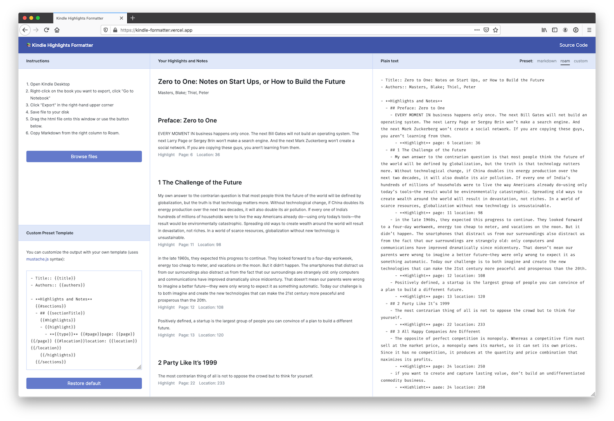

# Kindle Highlights Formatter

Website: https://kindle-formatter.com/

A simple tool for cleaning up Kindle highlights exported via the desktop app. The result is plain text you can paste to your note-taking app (Roam, Notion, Evernote).

## Run locally

Just open `index.html` in your browser. That's it!

No build process, no dependencies, no server needed.

## Privacy Note

Highlights are processed in the browser window and they aren't uploaded anywhere.
